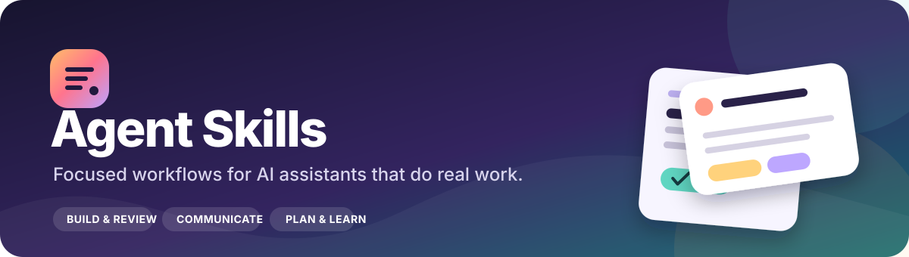

# Agent Skills for Useful AI Workflows

  

  <strong>Focused instructions that help AI agents do useful work—and show how they did it.</strong> 
  Practical <code>SKILL.md</code> workflows for building, writing, planning, learning, and everyday decisions.

  
  
  

## What are Agent Skills?

An **Agent Skill** is a reusable workflow that tells an AI assistant when a task fits, what steps matter, and what a useful result should include. These are more than one-line prompt recipes: each skill is meant to guide an AI agent toward a clear, reviewable outcome, with practical checks and honest limits.

This public collection includes AI assistant skills for interface design and review, communication, planning, learning, research, troubleshooting, and more. The files use the open `SKILL.md` format; they work in products that support Agent Skills, but installation and tool access vary by assistant.

## Featured workflow: design to ship

**[Design to ship reviewer](skills/design-to-ship-reviewer/SKILL.md)** helps a coding-capable agent turn a product brief into a coherent interface, work with the project's existing components, inspect the result in a browser, and report visible quality issues. It emphasizes real screenshots, responsive behavior, accessibility basics, and evidence—not vague instructions to “make it beautiful.”

> Try it: “Review this app against the brief, improve the most important screen using the existing design system, check it at desktop and mobile sizes, and show me what you verified.”

## Browse the AI skills collection

| Area | Skill | What it helps with | Status |
|---|---|---|---|
| **Build & review** | [Design to ship reviewer](skills/design-to-ship-reviewer/SKILL.md) | Shape, implement, and review an interface with browser evidence | New workflow; evaluation pending |
| Documents | [Document to next steps](skills/document-to-next-steps/SKILL.md) | Understand a letter or notice and list its stated actions | Research draft |
| Communication | [Inbox to action list](skills/inbox-to-action-list/SKILL.md) | Turn supplied messages into actions, dates, and draft replies | Starter workflow |
| Communication | [Meeting prep and follow-up](skills/meeting-prep-follow-up/SKILL.md) | Prepare an agenda and capture decisions, owners, and next steps | Starter workflow |
| Communication | [Write a clear reply](skills/write-a-clear-reply/SKILL.md) | Draft a natural reply based on the facts provided | Starter workflow |
| Decisions | [Compare my options](skills/compare-my-options/SKILL.md) | Compare choices against your priorities and recommend a next step | Starter workflow |
| Research | [Buy with confidence](skills/buy-with-confidence/SKILL.md) | Compare current products, prices, and trade-offs before purchase | Starter workflow |
| Planning | [Plan my week](skills/plan-my-week/SKILL.md) | Turn commitments and available time into a realistic weekly plan | Starter workflow |
| Travel | [Plan a trip](skills/plan-a-trip/SKILL.md) | Build a sourced itinerary without booking anything | Starter workflow |
| Career | [Apply with accuracy](skills/apply-with-accuracy/SKILL.md) | Tailor an application to a role without inventing experience | Starter workflow |
| Learning | [Learn something new](skills/learn-something-new/SKILL.md) | Get a clear lesson, example, and practice matched to your level | Starter workflow |
| Troubleshooting | [Troubleshoot step by step](skills/troubleshoot-step-by-step/SKILL.md) | Diagnose a problem safely, one meaningful change at a time | Starter workflow |

## Use a skill

1. Open the skill folder that matches your task and review its `SKILL.md`.
2. Give the file to an AI assistant that supports Agent Skills, or follow that product's current installation instructions.
3. Ask for the example task shown in the skill, then provide only the context it needs.
4. Review important claims, sources, and proposed actions before relying on the result.

Platform support differs: a skill can describe a workflow, but it cannot give an assistant tools or permissions that the platform does not provide. The repository does not claim that every skill works identically in every AI product.

## How we build these AI workflows

- Start with a specific user job, not a trend or a broad “do everything” prompt.
- Prefer practical methods, checkable outputs, and visible proof of what was reviewed.
- Keep skills focused and portable; use product-specific steps only when they are verified.
- Treat repositories, forum posts, and star counts as discovery signals—not proof that a skill works.
- Mark drafts honestly and improve them from realistic use, evidence, and feedback.
- Do not copy another creator's prompts, assets, or code without checking permission and attribution.

See [research, evidence, and candidate workflows](RESEARCH.md) for how priorities are chosen and what still needs evaluation.

## Help improve the collection

Try a workflow on a real task and tell us what was useful, confusing, or missing. If an Agent Skill saves you time, **star the repository or share it** so others can find it. Please include the task context and expected result when suggesting an improvement; specific feedback is easier to act on than “make it better.”

## Trust, privacy, and license

Skills guide an AI assistant; they do not make it infallible. Check important dates, measurements, and claims against their sources. Never provide passwords, one-time codes, private keys, payment details, or unrelated private information to a skill.

The skills are workflows and drafts, not professional certification or a guarantee of results. Review each file's boundaries before use. **No reuse license is currently included**, so do not assume that public visibility grants permission to redistribute or repackage the contents.

---

Built for clearer, more useful AI-agent workflows. Focused skills, practical checks, honest limits.

